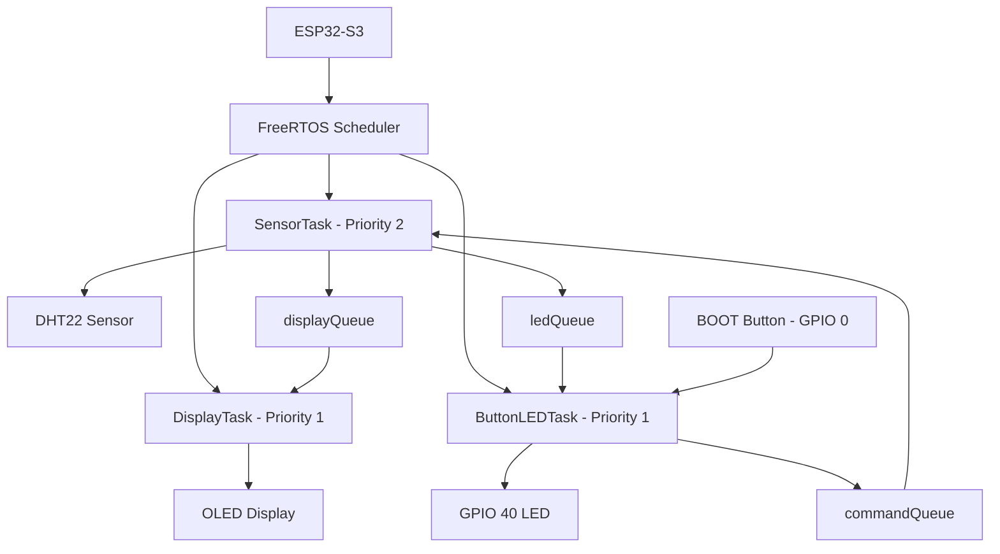

# ESP32-S3 FreeRTOS Task Deadline miss Detection system


## 1. Project Overview

This project implements an environmental monitoring system using an **ESP32-S3 development board**, a **DHT22 temperature and humidity sensor**, and an **OLED display**.

The system uses FreeRTOS to manage three independent tasks. It monitors environmental conditions, measures task execution time, detects simulated deadline overruns, and alerts the user through an LED and OLED display.

The user can acknowledge and reset an active warning using the ESP32-S3 onboard BOOT button.

### Main objectives

- Measure temperature and humidity using a DHT22 sensor.
- Display sensor readings on an OLED screen.
- Implement three independent FreeRTOS tasks.
- Use queues for communication between tasks.
- Monitor task execution time and detect deadline overruns.
- Indicate warnings using an LED and OLED display.
- Allow the user to acknowledge warnings using the onboard BOOT button.

## 2. Hardware Components

| Component | Purpose |
|---|---|
| ESP32-S3-DevKitC-1 | Main microcontroller and FreeRTOS platform |
| DHT22 sensor (DFRobot V2, 3-pin) | Temperature and humidity measurement |
| SSD1306 OLED (128 × 64) | Displays sensor readings and system status |
| LED | Visual warning indicator |
| Onboard BOOT button | User input for warning acknowledgement |
| Breadboard and jumper wires | Hardware connections |

## 3. Hardware Connections

### DHT22 sensor

| DHT22 pin | ESP32-S3 connection |
|---|---|
| VCC (Red) | 3.3V |
| DATA (Green) | GPIO 5 |
| GND (Black) | GND |

### OLED display

| OLED pin | ESP32-S3 connection |
|---|---|
| VCC | 3.3V |
| GND | GND |
| SDA | GPIO 8 |
| SCL | GPIO 9 |

The OLED uses I2C communication with address `0x3C`.

### LED and button

| Component | ESP32-S3 connection |
|---|---|
| LED | GPIO 40 |
| Onboard BOOT button | GPIO 0 |

The BOOT button is configured as an active-low input using `INPUT_PULLUP`. No external button is required.

**Note:** Do not hold the BOOT button while resetting or powering on the board, because GPIO 0 is also used for the ESP32 boot-mode selection.

## 4. Software Architecture

The project uses three FreeRTOS tasks, each with a separate responsibility.

### Task 1: SensorTask

- Priority: 2 (higher priority)
- Reads temperature and humidity from the DHT22 sensor.
- Measures task execution time.
- Detects execution times exceeding the configured task period.
- Simulates a deadline overrun for testing.
- Sends sensor information to the other tasks using queues.
- Processes warning acknowledgement commands.

### Task 2: DisplayTask

- Priority: 1 (lower priority)
- Receives sensor information through `displayQueue`.
- Updates the OLED display.
- Displays temperature and humidity during normal operation.
- Displays a warning when a deadline is missed.

### Task 3: ButtonLEDTask

- Priority: 1 (lower priority)
- Monitors the onboard BOOT button.
- Detects button presses and applies debouncing.
- Sends an acknowledgement command through `commandQueue`.
- Controls the warning LED.
- Blinks the LED while a warning is active and turns it off when the warning is acknowledged.

## 5. FreeRTOS Task Communication

Queues are used to transfer information and commands between tasks.

| Queue | Direction | Purpose |
|---|---|---|
| `displayQueue` | SensorTask → DisplayTask | Transfers sensor readings and warning status |
| `ledQueue` | SensorTask → ButtonLEDTask | Transfers sensor readings and warning status |
| `commandQueue` | ButtonLEDTask → SensorTask | Transfers the warning acknowledgement command |

The sensor data is transferred using a structure containing:

- Temperature
- Humidity
- Execution time
- Sensor validity
- Deadline-missed status

The two sensor data queues have a length of one and use `xQueueOverwrite()` to keep the latest information.

The command queue has a length of five.

### Task communication diagram



## 6. Task Priorities and Scheduling

Two priority levels are used:

| Task | Priority | Reason |
|---|---:|---|
| SensorTask | 2 | Sensor acquisition and deadline monitoring are the main system responsibilities |
| DisplayTask | 1 | Display updates are important but do not need to take priority over sensor monitoring |
| ButtonLEDTask | 1 | Button monitoring and LED control are secondary activities |

SensorTask has the highest priority because collecting sensor data and monitoring execution time are the main objectives of the system.

The other two tasks have lower priorities because displaying information and controlling the LED can be handled independently.

## 7. FreeRTOS Timing Functions

The project uses FreeRTOS timing functions to schedule tasks.

### `vTaskDelay()`

This function suspends a task for a specified number of ticks. It is used in tasks that do not require precise periodic execution.

### `vTaskDelayUntil()`

This function is used in SensorTask to maintain a periodic execution schedule.

The configured task period is:

```cpp
const uint32_t TASK_PERIOD_MS = 2000;
```

The system uses a 2000 ms period for sensor monitoring.

## 8. Deadline Monitoring and Simulation

The system measures execution time using `millis()`.

The configured normal workload is:

```cpp
const uint32_t NORMAL_WORK_MS = 250;
```

The simulated overrun workload is:

```cpp
const uint32_t OVERRUN_WORK_MS = 2500;
```

The program deliberately simulates an overrun every fifth sensor cycle.

When the measured execution time exceeds the configured 2000 ms period, the system activates the warning.

Example Serial Monitor output:

```text
Temperature: 22.10 C
Humidity: 23.00 %
Execution time: 256 ms
WARNING ACTIVE

Simulating deadline overrun...
!!! DEADLINE MISSED !!!

Temperature: 22.10 C
Humidity: 23.00 %
Execution time: 2506 ms
WARNING ACTIVE
```

This simulation demonstrates how the system responds when a task takes longer than its configured period.

**Note:** The current implementation measures workload execution duration and compares it with the configured period. It is a simulated overrun test, rather than a complete measurement of every possible real-time scheduling deadline.

## 9. Warning Acknowledgement

When a deadline overrun is detected:

1. The system activates the warning state.
2. The OLED displays the warning.
3. The LED blinks to indicate the warning.
4. The user presses the onboard BOOT button.
5. ButtonLEDTask detects the press and sends an acknowledgement through `commandQueue`.
6. SensorTask receives the command and clears the warning state.
7. The system returns to normal operation.

Example Serial Monitor output after acknowledgement:

```text
BOOT pressed: warning reset
Warning acknowledged!

Temperature: 22.10 C
Humidity: 22.90 %
Execution time: 255 ms
SYSTEM NORMAL
```

## 10. OLED Display Behaviour

The OLED is used to show the current system status.

**Normal operation:**
- Temperature
- Humidity
- System normal status

**Warning operation:**
- Deadline missed warning
- Warning status

The DisplayTask is the only task that accesses the OLED. Therefore, a mutex is not required for OLED access in this implementation, because there are no concurrent display operations from multiple tasks.

## 11. How to Build and Run the Project

### Requirements

- Arduino IDE 2.x
- ESP32 board support package
- ESP32-S3-DevKitC-1 board
- DHT sensor library
- Adafruit GFX library
- Adafruit SSD1306 library

### Steps

1. Connect the ESP32-S3 to the computer using USB.
2. Open the project in Arduino IDE.
3. Select **ESP32S3 Dev Module** as the board.
4. Select the correct COM port.
5. Check the hardware connections.
6. Compile and upload the program.
7. Open Serial Monitor.
8. Set the baud rate to **115200**.
9. Observe the sensor readings and system status.
10. Wait for the simulated deadline overrun.
11. Press the onboard BOOT button to acknowledge the warning.

## 12. Testing and Results

The following tests have been performed and confirmed through Serial Monitor output:

| Test | Expected behaviour | Result |
|---|---|---|
| Temperature measurement | DHT22 provides temperature readings | Passed |
| Humidity measurement | DHT22 provides humidity readings | Passed |
| Normal execution | Execution time is approximately 250–260 ms | Passed |
| Simulated overrun | Execution time exceeds 2000 ms | Passed |
| Deadline detection | System reports `DEADLINE MISSED` | Passed |
| BOOT button | Button press is detected | Passed |
| Queue acknowledgement | SensorTask receives acknowledgement | Passed |
| Warning reset | System returns to `SYSTEM NORMAL` | Passed |

The OLED warning and LED behaviour should also be visually verified during the final hardware demonstration.

## 13. Conclusion

This project demonstrates the use of FreeRTOS on an ESP32-S3 microcontroller for a simple real-time environmental monitoring application.

The system uses three independent tasks, different task priorities, queues for inter-task communication, and FreeRTOS timing functions.

The DHT22 sensor provides environmental measurements, while the OLED displays the system status. A simulated deadline overrun demonstrates how execution-time monitoring can detect an excessive workload. The onboard BOOT button provides a way for the user to acknowledge and reset the warning.

The project provides practical experience with task scheduling, inter-task communication, timing, sensor integration, and user interaction in an embedded real-time system.

---


## 14. Project Information

**Project title:** ESP32-S3 FreeRTOS task Deadline Detection System

**Platform:** ESP32-S3-DevKitC-1

**Programming environment:** Arduino IDE 2.x

**Operating system:** FreeRTOS

**Main programming language:** C++

**Communication:** I2C and FreeRTOS queues

**Sensors:** DHT22 temperature and humidity sensor

**Display:** SSD1306 OLED 128 × 64

**Repository:** Add your GitHub repository URL here.

**Contributors:** Santteri karjalainen, Vahid Hakimi, Zohaib Salman
